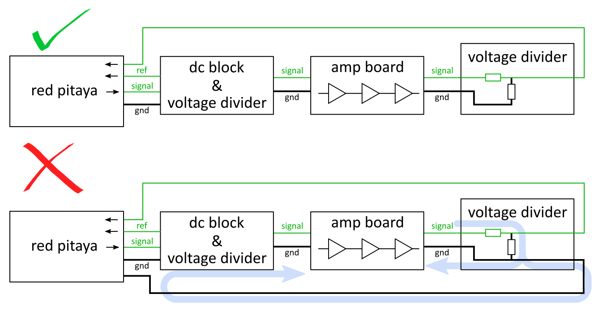
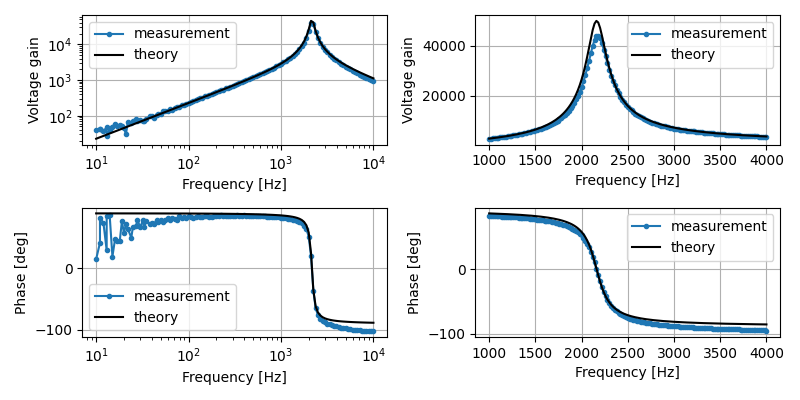

# 05.06.2025

I assembled a second copy of the amplifier board (see the directory with the measurements from the first one for details). As I was missing the exact SMD resistors needed, I used a parallel combination of two other resistors in a few places. Not pretty but it seems to get the job done.

## Troubleshooting amplifier oscillations

The first round of measurements failed as the amplifier seems to oscillate at a few kHz. I believe I have seen this problem when measuring the first amplifier too (though I may have failed to write it down). This might have been caused by a shared return path between the input and output side of the amplifier providing a weak (but enough to cause oscillations, due to the large gain) feedback loop.

After some more reflection and testing: The oscillations do not appear with the first configuration in the following picture and they do with the second configuration.

The main problem seems to be the ground loop in the second case. The return currents from the output of the amplifier flow through the ground connection between the red pitaya and the input of the amplifier, which may be causing weak crosstalk from the amplifier output to its input.

## Gain measurements

The gain measurements match theory and the first amplifier quite closely:

